# LODGaZilla

**Every file format, billions of points, one timeline.** Because "open it in Excel"
stopped working three gigabytes ago.

Got a folder of logs nobody can open, a sensor that samples way too often, and a video
of the exact moment it all went wrong? LODGaZilla puts them on one timeline.

- **Every file format. Really.** Plugins read the usual suspects (CSV, JSON, binary
  logs, GPX…). For the format your logger invented last Tuesday, drop a file on the AI
  panel: Magic drop works it out and plots it. Need it again? The AI writes you a
  plugin.
- **Organise the pile.** Group recordings by date or by any key/value you add (site,
  rider, firmware, whatever), then filter down to the one run you're after.
- **Plot it every which way.** Lines, stacked lanes, events and states, X/Y, 3D,
  spectra, sample intervals, maps and 3D maps, and video synced to the data.
- **Plug in anything.** Plugins import, export, or pull data straight off devices:
  data loggers, development kits, sensor boxes.
- **Fast.** Billions of points, zoomed and panned without waiting. The catch: each
  source file is converted once. For a big log, that's a coffee break; after that,
  it's quick every time.
- **Look, don't touch.** LODGaZilla is a viewer. Your data stays exactly as it was;
  you only edit metadata and attachment links.

**Who's it for?** Anyone with more data than patience: vehicle, drone and robotics
testers, sports scientists with sensors on athletes and cameras rolling, field teams
running dozens of loggers, and developers tuning algorithms against hours of raw
recordings. If it has a timestamp, LODGaZilla wants to see it. And when the question
is "what actually happened at 12:04:31?", the synced video answers it.

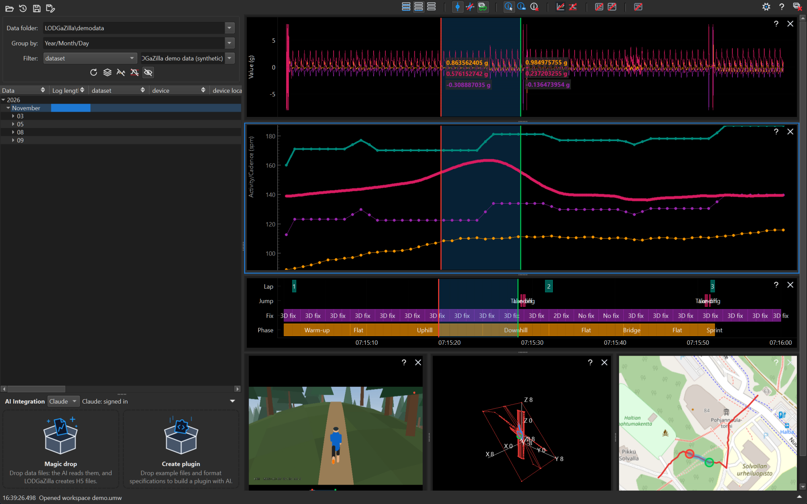

## Getting started

### 1. Install Git

Git downloads LODGaZilla and keeps it up to date, and plugins are installed with it
too. It's free:

- **Windows:** download the installer from [git-scm.com](https://git-scm.com/downloads/win)
  and run it. The default choices are fine; just keep clicking **Next**.
- **macOS:** open Terminal and type `git --version`. If Git is missing, macOS offers to
  install it (as part of the Command Line Tools). Say yes.
- **Linux:** install it with your package manager, for example
  `sudo apt install git` (Ubuntu, Debian) or `sudo dnf install git` (Fedora).

Check that it works: open a new terminal and run `git --version`. It should print a
version number, such as `git version 2.47.1`.

Rather click than type? [GitHub Desktop](https://desktop.github.com/) does the same
with buttons.

### 2. Get LODGaZilla

LODGaZilla lives on GitHub:
[github.com/RikuRaitis/LODGaZilla](https://github.com/RikuRaitis/LODGaZilla). In a
terminal, go to the folder where you want it, such as `Documents`, and run:

```
git clone https://github.com/RikuRaitis/LODGaZilla.git
```

This creates a `LODGaZilla` folder. To update later, run `git pull` in that folder.

No Git? On the repository page, click the green **Code** button and choose
**Download ZIP**, then unzip it. To update, download a new ZIP. You'll still need Git
for plugins.

### 3. Install Python

You need Python 3.11 or newer. On Windows, download it from
[python.org](https://www.python.org/downloads/) and tick **Add Python to PATH** in the
installer. Missing that box is the number one reason for "python is not recognized".

### 4. Start it

On Windows, double-click `LODGaZilla.bat` in the LODGaZilla folder. On any platform,
you can also open a terminal in that folder and run:

```
python -m src.app.lodgazilla
```

(On Linux and macOS the command may be `python3`.) To open a data folder straight away,
add it to the command, for example `python -m src.app.lodgazilla D:\logs`.

The first start installs the Python libraries LODGaZilla needs, which takes a few
minutes. Later starts skip that step unless something has changed. If you prefer a
virtual environment, create and activate it before the first start
(`python -m venv .venv`).

### 5. Plot your first data

No data yet? No problem. Pick one:

**Try the demo data.** A few synthetic forest runs with sensors, GNSS and video, made
for poking at.

- **On the first start,** LODGaZilla offers to create it. Say yes, and it generates
  the data in the background with a progress bar. It takes a while, because it renders
  two videos; **Cancel** stops it, and the next start asks again.
- **Later,** choose **Settings > General > Demo data > Re-generate demo data**. This
  deletes the `demodata` folder, including any changes you made there, and creates it
  again.

When it's ready, click **Open workspace** at the top left and open `demodata/demo.umw`
to see every card type at once. See [Demo data](#demo-data) for what's inside.

**Drop your own file.** Got a log lying around? Drag it onto the **Magic drop** box in
the AI panel below the Navigator. [Magic drop](#magic-drop-import-any-file-with-ai) works out the format
and converts it into a new folder in the Navigator, no plugin needed; double-click a
data series there to plot it. It needs the Claude Code or Codex tool, as described there.

**Open a data folder.** Once you have files and plugins for them, choose the folder in
the **Data folder** field at the top left (its dropdown starts with **[Browse…]**).
Double-click a folder that has no H5 files yet to convert it, then double-click a data
series to plot it, or drag it into the plot area on the right.

## Using LODGaZilla

### The main window

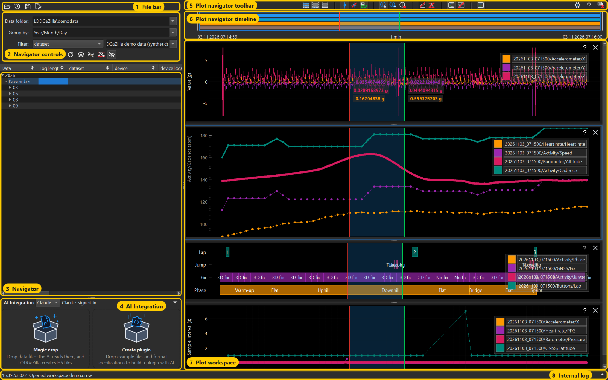

| # | Area | What it is |
| --- | --- | --- |
| 1 | **File bar** | Open workspace, Open recent workspace, Save workspace, Save workspace as. |
| 2 | **Navigator controls** | The data folder, **Group by** and **Filter** fields, and the [Navigator buttons](#buttons). |
| 3 | **Navigator** | The folders, metadata, data series and attachments in the data folder. |
| 4 | **AI Integration** | The AI panel: the [Magic drop](#magic-drop-import-any-file-with-ai) and [Create plugin](#create-plugin) boxes. Open by default; the arrow in its header closes it to one row. |
| 5 | **Plot navigator toolbar** | Buttons that apply to all cards, then Settings, Help and Close all. |
| 6 | **Plot navigator timeline** | A bar per card on a shared timeline, with the markers and the selection. |
| 7 | **Plot workspace** | The cards. |
| 8 | **Internal log** | What LODGaZilla is doing: loading, imports, warnings. Click it to expand. |

Drag the dividers between the areas to resize them.

### Buttons

**File bar** (top left):

| Icon | Button | Does |
| --- | --- | --- |
| <picture><source media="(prefers-color-scheme: dark)" srcset="assets/navigator_icons/dark/workspace-open.svg"></picture> | Open workspace | Opens a saved [workspace](#workspaces) (Ctrl+O). |
| <picture><source media="(prefers-color-scheme: dark)" srcset="assets/navigator_icons/dark/workspace-open-recent.svg"></picture> | Open recent workspace | Lists the last ten workspaces. |
| <picture><source media="(prefers-color-scheme: dark)" srcset="assets/navigator_icons/dark/workspace-save.svg"></picture> | Save workspace | Saves the current view (Ctrl+S). |
| <picture><source media="(prefers-color-scheme: dark)" srcset="assets/navigator_icons/dark/workspace-save-as.svg"></picture> | Save workspace as | Saves it to a new file (Ctrl+Shift+S). |

**Navigator buttons** (centered above the tree):

| Icon | Button | Does |
| --- | --- | --- |
| <picture><source media="(prefers-color-scheme: dark)" srcset="assets/navigator_icons/dark/refresh.svg"></picture> | Refresh | Reads the data folder again. |
| <picture><source media="(prefers-color-scheme: dark)" srcset="assets/navigator_icons/dark/batch-h5.svg"></picture> | Batch | Runs a plugin action, such as generating H5 files, on every folder in the data folder, after an "Are you sure?" |
| <picture><source media="(prefers-color-scheme: dark)" srcset="assets/navigator_icons/dark/sample-loss.svg"></picture> | Sample loss | Highlights series with dropped samples. |
| <picture><source media="(prefers-color-scheme: dark)" srcset="assets/navigator_icons/dark/clipping.svg"></picture> | Clipping | Highlights series that hit their sensor's limits. |
| <picture><source media="(prefers-color-scheme: dark)" srcset="assets/navigator_icons/dark/hide-irrelevant.svg"></picture> | Hide irrelevant series | Hides series the importer marks as hidden, such as system counters. |

**Plot navigator toolbar**, from left to right. A toggle button shows its current state,
so its icon changes when you click it; the table shows each one switched on.

| Icons | Buttons | Do |
| --- | --- | --- |
| <picture><source media="(prefers-color-scheme: dark)" srcset="assets/plot_icons/dark/time-axis-all.svg"></picture> <picture><source media="(prefers-color-scheme: dark)" srcset="assets/plot_icons/dark/time-axis-bottom.svg"></picture> <picture><source media="(prefers-color-scheme: dark)" srcset="assets/plot_icons/dark/time-axis-none.svg"></picture> | Time axis | Show the time axis on every card, only on the bottom one, or on none. |
| <picture><source media="(prefers-color-scheme: dark)" srcset="assets/plot_icons/dark/markers-linked.svg"></picture> | Markers linked | All cards share the same markers. |
| <picture><source media="(prefers-color-scheme: dark)" srcset="assets/plot_icons/dark/snap-nearest-timestamp.svg"></picture> | Snap to nearest timestamp | A marker jumps to the nearest sample instead of staying where you clicked. |
| <picture><source media="(prefers-color-scheme: dark)" srcset="assets/plot_icons/dark/views-linked.svg"></picture> | Plot views linked | Zooming or panning one time card zooms and pans them all. |
| <picture><source media="(prefers-color-scheme: dark)" srcset="assets/plot_icons/dark/info-clicked.svg"></picture> <picture><source media="(prefers-color-scheme: dark)" srcset="assets/plot_icons/dark/info-all.svg"></picture> <picture><source media="(prefers-color-scheme: dark)" srcset="assets/plot_icons/dark/info-off.svg"></picture> | Values boxes | Show values only in the card where you placed the marker, in all cards, or nowhere. |
| <picture><source media="(prefers-color-scheme: dark)" srcset="assets/plot_icons/dark/show-sample-loss.svg"></picture> <picture><source media="(prefers-color-scheme: dark)" srcset="assets/plot_icons/dark/show-clipping.svg"></picture> | Sample loss, Clipping | Show or hide those areas on the cards. |
| <picture><source media="(prefers-color-scheme: dark)" srcset="assets/plot_icons/dark/legend-shown.svg"></picture> <picture><source media="(prefers-color-scheme: dark)" srcset="assets/plot_icons/dark/card-controls-shown.svg"></picture> | Legends, Card controls | Show or hide every card's legend and header controls, for more room. |
| <picture><source media="(prefers-color-scheme: dark)" srcset="assets/plot_icons/dark/plot-navigator-shown.svg"></picture> | Plot navigator | Show or hide the timeline with the card bars. |
| <picture><source media="(prefers-color-scheme: dark)" srcset="assets/plot_icons/dark/plugin.svg"></picture> | Plugins | One icon per plugin with its own window; a plugin can bring its own icon. |
| <picture><source media="(prefers-color-scheme: dark)" srcset="assets/plot_icons/dark/settings.svg"></picture> <picture><source media="(prefers-color-scheme: dark)" srcset="assets/plot_icons/dark/help.svg"></picture> <picture><source media="(prefers-color-scheme: dark)" srcset="assets/plot_icons/dark/close-all-plots.svg"></picture> | Settings, About, Close all | Settings, **About LODGaZilla** (version, author, and a button that opens this README in your Markdown viewer), and closing every card. |

**Card header** (top right of each card):

| Icon | Button | Does |
| --- | --- | --- |
| <picture><source media="(prefers-color-scheme: dark)" srcset="assets/plot_icons/dark/help.svg"></picture> | Help | Lists every mouse action of this card. When in doubt, click it. |
| <picture><source media="(prefers-color-scheme: dark)" srcset="assets/plot_icons/dark/time-offset.svg"></picture> | Time offset | Sets the card's [time offset](#time-offsets). Highlighted while an offset is set. |
| <picture><source media="(prefers-color-scheme: dark)" srcset="assets/plot_icons/dark/close.svg"></picture> | Close | Closes the card. |

Cards that draw lines add the [draw style](#lines-or-points) buttons <picture><source media="(prefers-color-scheme: dark)" srcset="assets/plot_icons/dark/draw-auto.svg"></picture>
<picture><source media="(prefers-color-scheme: dark)" srcset="assets/plot_icons/dark/draw-lines.svg"></picture> <picture><source media="(prefers-color-scheme: dark)" srcset="assets/plot_icons/dark/draw-points.svg"></picture> (Auto, Lines, Points).
Some cards add their own controls next to these: the [sample limit](#sample-limits)
dropdown, the Frequency card's FFT settings <picture><source media="(prefers-color-scheme: dark)" srcset="assets/plot_icons/dark/fft-settings.svg"></picture>, the 3D plot's reset
camera button <picture><source media="(prefers-color-scheme: dark)" srcset="assets/plot_icons/dark/reset-camera.svg"></picture>, the Map type (street or satellite) and the Video
card's preview size. The [3D Map](#3d-map) puts its map controls along the left of its
top strip. Drag the strip at the top of a card to move it, and its bottom edge
to resize it.

### The Navigator

Each recording folder has an **Info** row with its metadata. Edit the values, or add
your own keys at **[ADD NEW KEY]**, such as diver, place or weather. Then use them:

- **Group by** arranges recordings by date (year, month, day) or by any metadata key.
- **Filter** shows only the recordings with a given metadata value.

Right-click a column header to choose which columns are shown. Right-click a folder
for:

- **Multi-series**: all the folder's series in one card.
- **Attach**: link a video, images or audio to the folder. Removing a link later never
  deletes the file.
- **Show in file manager.**
- The plugin actions, last and each starting with **Plugin:**, such as
  **Plugin: Generate / update H5 files**.

Right-click a year, a month or several selected folders to run the plugin actions on
each of them.

### Opening cards and dragging data

- **Double-click** a series to open it in its default card. If the active
  (highlighted) card fits, the series goes there instead. Press **Esc** or click empty
  space to make no card active.
- **Right-click** one or more series to choose the card type, or **Active card**.
- **Drag** series from the Navigator onto a card to add them, or into empty space to
  open a new card. Hold a drag between two cards for a second and the
  **Card drop selector** offers every card type that fits.


| You select                           | Default card                                            |
| ------------------------------------ | ------------------------------------------------------- |
| One series                           | Multi-series                                            |
| Two numeric series                   | X/Y, or Map for latitude and longitude                  |
| Three numeric series                 | 3D plot, or 3D Map for latitude, longitude and altitude |
| More, or a mix with events or states | Multi-series                                            |
| A video or image                     | Video or Image                                          |

### Legends

Each card's legend lists its series:

- Click a colour swatch to change the colour.
- Drag a series to reorder it, or onto another card's legend to move it there.
- Right-click a series to remove it from the card.

X/Y, 3D plot and map cards group their legend by graph: a heading and one row per axis
(X/Y, X/Y/Z, Lat/Lon or Lat/Lon/Alt). Drop a series on a row to assign it; hold
**Ctrl** while dropping to swap two rows. An axis shows **empty** until it gets a
series, and the graph appears once all its axes have one. Right-click a heading to
remove the whole graph.

### Markers and selection

Every card except Image has two markers:


| Action                            | Result                          |
| --------------------------------- | ------------------------------- |
| Left-click                        | Places the red first marker.    |
| Right-click                       | Places the green second marker. |
| Double-click with the same button | Removes that marker.            |
| Drag a marker                     | Moves it, on time cards.        |

With both markers placed, the time between them is the **selection**, painted blue.
With **Markers linked**, every card shows the same markers. On X/Y, 3D plot and map
cards a click marks the nearest point, and the selection is that stretch of the graph
or track.

A **values box** shows each series' value at a marker. Hover over it for the details;
with a selection, they include minimum, maximum, average, median and a histogram.
Click a box to pin the details so you can copy them.

### The Plot navigator

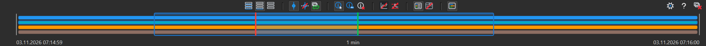

The Plot navigator sits above the cards. Its toolbar holds the buttons that apply to
every card (see [Buttons](#buttons)); below it, each card has a bar on a shared
timeline, so you see at a glance which recordings overlap and where the markers are.

- Drag a bar's ends to trim that card's time range; right-click a bar to reset it.
- Drag a bar sideways to give the card a [time offset](#time-offsets), or up and down
  to reorder the cards.
- With **Plot views linked**, a frame shows the visible time range. Drag its edges to
  zoom all time cards, or its top strip to pan them.
- Click or right-click the timeline to place the markers there too.

### Arranging cards

Drag a card by its top strip to move it. Maps, videos and images can sit side by side;
drag the divider between them to share the width. Closing a card leaves the others in
place.

### Time offsets

When two recordings' clocks disagree (they always do), shift a card in time: click the
clock in its header and type the offset in seconds, or drag its bar sideways in the
Plot navigator. Only the view moves; the data stays as it is. In a Multi-series card,
select a trace first to shift just that series. On a Video card, the offset is the
video's sync offset.

### Sample limits

X/Y, 3D plot, Map and 3D Map cards draw every Nth sample, up to a limit per graph:
100k for X/Y, 50k for 3D plot and 20k for maps. The dropdown in the card header shows
how much is drawn, such as **25% · 100k max**, in bold when not everything fits.
Choose a higher limit for more detail or **all** for every sample; the card slows down
as the number grows. Trimming the time range in the Plot navigator adds detail too.

### Lines or points

Cards that draw series as lines (Line, Multi-series, Sample interval, X/Y, 3D plot,
Map and 3D Map) have three buttons in their header: **Auto**, **Lines** and
**Points**. Auto is each card's usual drawing; a Line card, for example, adds points
when you zoom in close. Lines never shows points, and Points shows only the samples,
with no lines between them.

### Workspaces

**Save workspace** (Ctrl+S) saves everything you see into a `.umw` file: the cards,
their layout, series, zoom and settings, both markers, and the Navigator's folder,
grouping and filter. **Open workspace** (Ctrl+O) brings it all back exactly as it was.
**Open recent workspace** lists the last ten. Paths are stored relative to the
workspace file, so a workspace saved next to its data still opens after you move the
folder.

## Cards

Everything you plot lives in a **card**. Mix and match them; they all share the same
time and the same markers.


| Card                                | Shows                                                                 |
| ----------------------------------- | --------------------------------------------------------------------- |
| [Line](#line)                       | Numeric series against time.                                          |
| [Multi-series](#multi-series)       | Many series in one card, each in its own lane, plus video filmstrips. |
| [Event/state](#eventstate)          | States and events as labelled bars.                                   |
| [Sample interval](#sample-interval) | The time between samples: gaps, jitter and dropped data.              |
| [Frequency](#frequency)             | A spectrogram of one series.                                          |
| [X/Y](#xy)                          | One series against another.                                           |
| [3D plot](#3d-plot)                 | Three series in 3D.                                                   |
| [Map](#map)                         | GNSS tracks on a street or satellite map.                             |
| [3D Map](#3d-map)                   | GNSS tracks on a 3D map with terrain.                                 |
| [Video](#video)                     | Video in sync with the data.                                          |
| [Image](#image)                     | A picture, such as a route map.                                       |

Audio isn't a card of its own: attached audio becomes data series you can plot in
any time card.

### Line

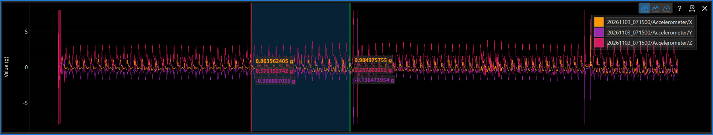

Numeric series against time. **Ctrl+wheel** zooms and dragging pans. Shaded areas mark
sample loss and clipping.

### Multi-series

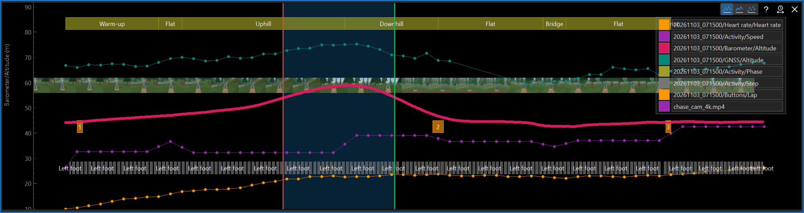

Many series in one card, each scaled into its own lane so they don't pile on top of
each other. Click a trace to select it and show its Y axis, drag it up or down to move
it, and **Ctrl+wheel** over the Y axis to scale it. Event and state series appear as
labelled bars.

A video can join as a **filmstrip**: a row of frames along the time axis. Drag a
video attachment onto the card to add one. Great for spotting the exact frame where
the runner hit the bridge.

### Event/state

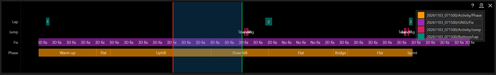

States and events, such as workout phase, GNSS fix or button presses, as labelled
bars along the time axis.

### Sample interval

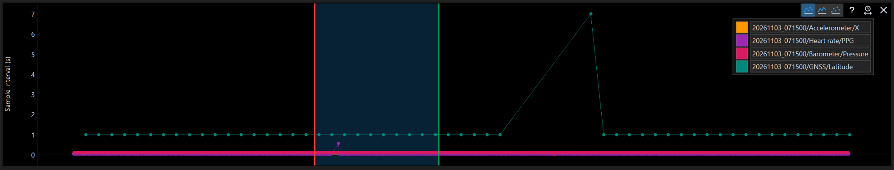

The time between consecutive samples. Dropped samples, gaps, jitter and rate changes
jump right out; above, the GNSS goes quiet for seven seconds under the trees. Drop
several series on one card to compare their timing. With both markers placed, the
values boxes show the interval statistics.

### Frequency

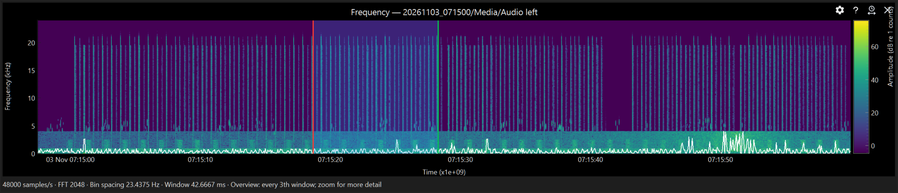

A spectrogram of one series, here the soundtrack of the demo video: time across, frequency up, colour for amplitude. The gear
button sets the FFT window, overlap and colour range, or an exact frequency band and
resolution. A white line follows the strongest frequency. The card needs regularly
sampled data; it leaves gaps rather than guessing across missing samples.

### X/Y

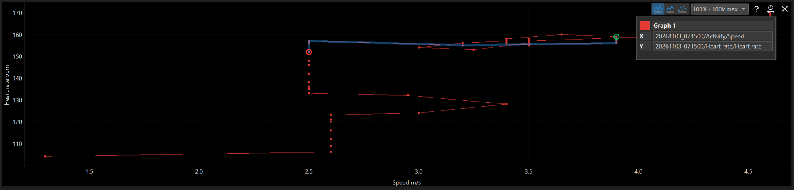

One series against another, such as heart rate against speed. A card can hold several
graphs.

### 3D plot

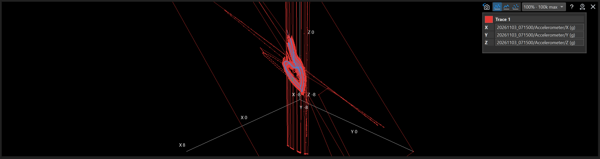

Three series as X, Y and Z, such as the three accelerometer axes. Drag to rotate,
**Ctrl+drag** to pan and **Ctrl+wheel** to zoom; the camera button resets the view. A
card can hold several traces.

### Map

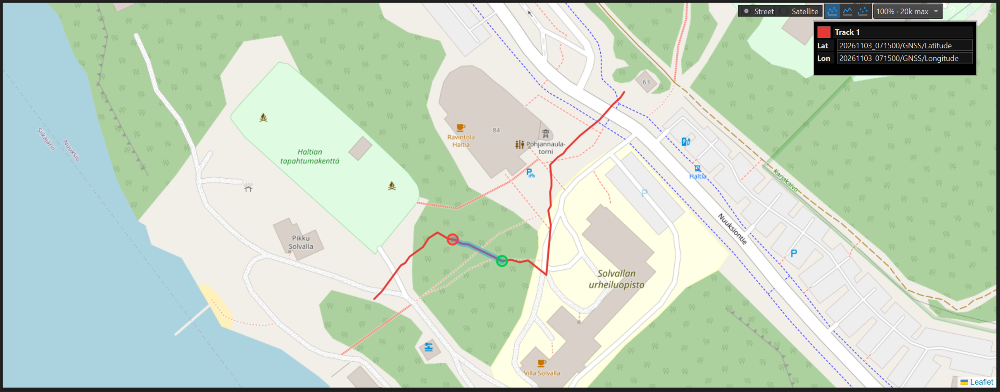

GNSS tracks on a street or satellite map. Recognised latitude and longitude series
open here by default. A card can hold several tracks.

### 3D Map

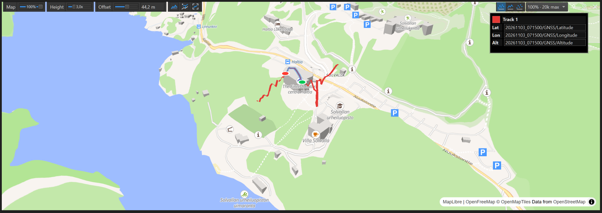

GNSS tracks in 3D over terrain and buildings, which hide the track where it goes
behind them. A new card frames the whole track, with heights exaggerated three times
to make those hills look properly hilly. The controls along the card's top:

- **Map**: the map's opacity; 0% hides the map and its terrain.
- **Height**: altitude exaggeration, from 1x to 10x, for both the terrain and the track.
- **Offset**: moves the track up or down, in metres. Drag the slider or type a value.
- **Follow ground**: draws the track on the ground and ignores its altitude. A track
  without altitude follows the ground by default.
- **Auto**: sets the offset so that the track's lowest point touches the ground.
  A new card does this by itself.
- **Center view**: brings the whole track back into view when you've lost it.

### Video

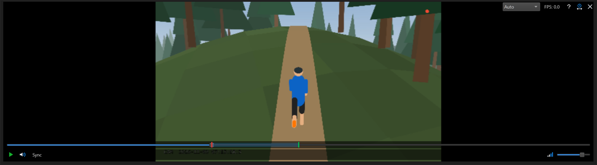

Video in sync with the data, with play, volume and a timeline that shows the markers.
To sync a video: press **Sync**, set the data marker at a moment you can recognise,
such as a lap press, and set the video marker at the same moment in the video.
LODGaZilla saves the offset with the video. Attach videos with **Attach > Video…** on
a folder; their soundtracks become audio series. See
[video controls and synchronization](src/gui/plots/video/README.md).

### Image

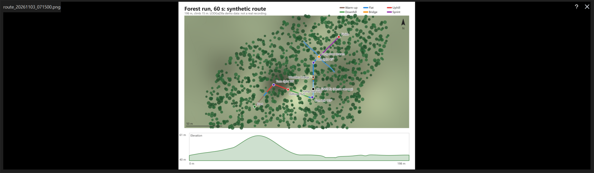

A picture attached to a folder, such as a route map or a photo of the test setup.
Attach images with **Attach > Images…**.

## Magic drop: import any file with AI

Got a file nobody has written a plugin for? Drop it on the **Magic drop** box in the
AI panel below the Navigator. That's all.

The AI panel shows two boxes side by side, **Magic drop** and **Create plugin**. A box
lights up while you drag files over it. Once you've used one, both shrink to a row
above the conversation, so you can drop more files on either. Close the panel to one
**AI Integration** row with the arrow in its header, and click the row to open it
again; LODGaZilla remembers which way you left it.

1. LODGaZilla creates a new folder in the data folder and copies the file there. The
   original stays where it was.
2. The AI, Claude or Codex as chosen in the panel header, reads the file, finds the
   data series, writes a parser and tests it. In the conversation it tells you the
   format, the series it found and what it assumed about units and time. It then asks
   whether the data looks right and whether you'd like a plugin for the format.
3. LODGaZilla runs the parser, writes the H5 file and the folder's `_info.json` with
   the fixed values the AI found, such as device and serial number. The new folder
   appears in the Navigator.

Tips:

- Type hints in the box under the conversation before your next drop, such as
  "column 3 is pressure in mbar". They go to the AI with the file.
- Drop several files at once and LODGaZilla asks whether they belong in one folder
  or one folder each.
- The play button turns into a stop button while Magic drop runs. Stopping, or a
  failure, removes the new folder.

Magic drop uses a command-line tool installed on your computer: **Claude Code**, or
**Codex** from OpenAI. LODGaZilla finds each on `PATH` or inside its VS Code extension,
or you can set its path. **Sign in** in the panel header opens the tool's own sign-in;
LODGaZilla never sees a password or key. The first drop with each tool asks whether
files may be sent to it (Claude to Anthropic, Codex to OpenAI). Don't drop files with
personal data, such as the location or heart rate of real people, unless you are
allowed to share them. The answers, whether each tool may read web pages, the cost
limit (Claude only, default $2 per drop or question) and the time limit (15 minutes)
are in **Settings > General > AI**.

Claude may only read the dropped files, write in its own working folder, run Python
and read web pages, such as the format's specification; everything else is denied.
Codex runs in its sandbox: it can write only in its working folder, the new data
folder and the temporary folder, and can search the web but its commands have no
network access; it's told to run only Python. Either way, the parser runs on your
computer, in a separate process with a time limit. Web access can be switched off
for each tool in Settings.

### Create plugin

Want a proper plugin instead, for a format you use every day, a device such as a data
logger over USB, or an export? Drop example files and the format specification on the
**Create plugin** box, say what you need (paste a link to the specification if there
is one), and press Enter.

1. On your first question LODGaZilla asks for the plugin's ID, such as
   `weather_logger_importer`, and creates `plugin/<id>` as its own Git repository.
2. The AI (Claude or Codex, as chosen in the panel header) reads your files and the
   plugin guide, asks what it needs to know, writes the plugin with its tests and runs
   them. LODGaZilla commits the plugin's changes after each answer; nothing is pushed.
3. Keep talking: each answer continues the same conversation. Drop more files on the
   box or the conversation whenever they help.
4. When the plugin works, restart LODGaZilla and enable it in **Settings > Plugins**.

Your files go to the plugin's `.lodgazilla_ai` folder, which is never committed, as
are the AI's instructions. The AI may write only in the plugin's folder and run
Python and Git there.

## Plugins

A plugin adds a file format or an action, such as an export. LODGaZilla runs fine
without any and still opens existing H5 files, images and videos.

Plugins are released separately, each in its own Git repository named
`LODGaZilla-<name>`. They'll be announced here as they become available.

### Installing plugins

In **Settings > Plugins**, add the GitHub account or Bitbucket workspace that publishes
the plugins under **Plugin sources**. LODGaZilla lists the `LODGaZilla-*` repositories
it finds there, with **Install** and **Update** buttons. New plugins start disabled:
restart LODGaZilla, then enable them in Settings.

LODGaZilla never stores passwords or tokens. Only install plugins you trust: a plugin
runs Python code with your permissions.

### Where plugin actions appear

| Where | What |
| --- | --- |
| Folder right-click | The plugin actions come last, each starting with **Plugin:**, for example **Plugin: Generate / update H5 files**. |
| Right-click on a year, a month or several selected folders | The same plugin actions, run on each visible folder. |
| **Batch** button in the Navigator | The plugin actions for every folder in the data folder. |
| Plot navigator toolbar | One icon per plugin with its own window. |

## Demo data

The demo data is a set of synthetic runs in `demodata/`. See
[Getting started](#5-plot-your-first-data) for how to create it.


| Session                              | Contents                                                                                                                                    |
| ------------------------------------ | ------------------------------------------------------------------------------------------------------------------------------------------- |
| `20261103_071500` Forest run, 60 s   | A watch with a 1000 Hz IMU, GNSS, barometer, heart rate, steps and more; a foot pod; a 4K chase-camera video; a 360 video; a route picture. |
| `20261105_174500`, `20261108_101500` | Two more 60 s runs with different metadata, for grouping and filtering.                                                                     |
| `20261109_060000` Long run, 2 h      | A 1000 Hz accelerometer and slower series, for zooming and sample limits.                                                                   |

The forest run hides a few problems for you to find:

- **Sample loss and clipping:** FIFO overflows drop IMU samples, and the jump landings
  and the steel bridge clip.
- **GNSS:** no fix under dense canopy.
- **Barometer:** one duplicated timestamp.
- **PPG:** timestamp jitter and a gap.
- **Vibration:** 50 Hz on the bridge.
- **Foot pod:** its clock runs 1.7 s ahead of the watch.
- **Chase camera:** started 4 s early and not synchronized. Sync it at a lap press,
  when the watch beeps and its screen lights up.

`demodata/README.md` has the details.

## Under the hood

### Why plotting is fast

- **Level-of-detail (LOD) summaries.** At import, each series is split into buckets,
  and each bucket's minimum and maximum are stored, at several zoom levels. Zoomed out,
  a card reads only as many buckets as the screen has pixels. Short peaks stay visible,
  because the minimum and maximum are kept. (Yes, that's where the name comes from.)
- **Every Nth sample.** X/Y, 3D plot and Map cards combine several series per point,
  so they draw every Nth sample instead, up to a [limit](#sample-limits) you choose.
- **Background work.** Reading data, statistics and video decoding run in the
  background, so the window stays responsive.
- **The GPU.** Video decodes on the graphics card when it can; the 3D cards draw
  with OpenGL and WebGL.

[HDF5](https://www.hdfgroup.org/solutions/hdf5/) is an open format for large numeric
data: a program can read a small part of a big array without loading the whole file.

### Plugin architecture

Each plugin is its own Git repository, installed as a folder under `plugin/`. There
are two kinds:

- **Importers** read one source format and return its data series. LODGaZilla does
  the rest: it writes the H5 file and its summaries, and runs imports in parallel.
- **UI plugins** add actions. An **operation** is a background job, such as exporting
  folders to CSV, which LODGaZilla lists in its menus. A plugin with its own window
  gets an icon in the Plot navigator toolbar.

Writing a plugin? See [the plugin API](docs/Plugin_API.md) and the
[H5 format guide](docs/H5_Format.md).

### Platforms

LODGaZilla is developed and tested on Windows 11. It is written in Python with
cross-platform libraries (Qt through PySide6, PyQtGraph, h5py and PyAV), so Linux and
macOS should work with little or no change. Nobody has tried yet, so be the first.


| Platform   | Status                                                                        |
| ---------- | ----------------------------------------------------------------------------- |
| Windows 11 | Tested. Main development platform.                                            |
| Linux      | Untested. Starts the same way. Video tries CUDA and VA-API hardware decoding. |
| macOS      | Untested. Starts the same way. Video tries VideoToolbox hardware decoding.    |

On Linux and macOS, video frames go through the CPU instead of staying on the GPU,
and cancelling an import stops its workers a little less abruptly.

## For developers

### H5 files

Each series is a group under `/series/<group>/<name>` with its timestamps, its
`value` dataset, optional original values in `value_raw`, and `lod/level_###`
summaries. The full layout, for plugin developers and AI agents alike, is in the
[H5 format guide](docs/H5_Format.md).

### Installing the requirements without starting

```
python tools/setup_environment.py
python tools/setup_environment.py --force
```

### Importing from the command line

With an importer plugin enabled:

```
python -m src.jobs.import_data "path/to/capture"
```

The H5 file is written next to the source.

### Tests

```
python tools/run_tests.py --isolated
python tools/run_tests.py --plugin plugin/<plugin id> --isolated
```

The first runs the core tests without any plugin, on a protected copy of the
settings. The second runs one plugin's tests against this checkout. The plain
`python -m unittest discover -s tests` works too, on the working checkout.

To test with really big data, `tools/create_large_h5_fixture.py 1024 --output-dir data/Synthetic`
creates a 1 GiB synthetic log and its H5 file: about 25 hours of three series at
1000 Hz. It needs a few GB of RAM.

To create the demo data by hand, run `python tools/create_demo_dataset.py`, or add
`--no-video --long-hours 0` for a one-minute version without videos.

### Starting for testing


| Command                                           | Use                                                                                                                                                    |
| ------------------------------------------------- | ------------------------------------------------------------------------------------------------------------------------------------------------------ |
| `python -m src.app.lodgazilla --default-settings` | Uses the committed `app_settings.json` instead of your local `app_settings_debug.json`. Changes are saved to `app_settings.json`, so don't commit them. |
| `python -m src.app.lodgazilla --no-plugins`       | Loads no plugin, as on a clean installation. Your plugin settings are kept.                                                                            |
| `python -m src.app.lodgazilla --help`             | Lists the options.                                                                                                                                     |

Copy `app_settings.json` to the ignored `app_settings_debug.json` to keep your recent
folders, plugin choices and column layouts out of Git.

### Versions and releases

LODGaZilla uses [Semantic Versioning](https://semver.org/): `1.0.0-beta.1`, then
`1.0.0`, `1.1.0`, `1.1.1`. The help (?) button's About dialog and the first lines of
`logs/lodgazilla.log` show the running version. What changed in each release is in
the [changelog](CHANGELOG.md), and how to make a release is in
[Releasing](docs/Releasing.md).

## License

Copyright (C) 2026 Riku Tervonen

LODGaZilla is free software: you can redistribute it and/or modify it under the terms
of the GNU General Public License as published by the Free Software Foundation, either
version 3 of the License, or (at your option) any later version. It is distributed in
the hope that it will be useful, but without any warranty; without even the implied
warranty of merchantability or fitness for a particular purpose. See [LICENSE](LICENSE)
for the full text (SPDX: `GPL-3.0-or-later`).

Plugins are separate projects in their own repositories, each with its own license.

## Third-party libraries and licenses

LODGaZilla stands on the shoulders of these open-source projects. Versions are the
ones pinned in `constraints.txt` for Windows and Python 3.11.

**Python libraries**, installed by the setup:

| Library | Version | Used for | License |
| --- | --- | --- | --- |
| [PySide6](https://doc.qt.io/qtforpython-6/) (Qt for Python, with shiboken6 and Qt itself) | 6.11.0 | The whole user interface, the web view for maps, OpenGL | LGPL-3.0 (or GPL-2.0 / GPL-3.0) |
| [PyQtGraph](https://www.pyqtgraph.org/) | 0.14.0 | Plotting in time, X/Y, Frequency and 3D plot cards | MIT |
| [NumPy](https://numpy.org/) | 1.25.2 | Number crunching everywhere | BSD-3-Clause |
| [h5py](https://www.h5py.org/) (with the bundled HDF5 library) | 3.16.0 | Reading and writing H5 files | BSD-3-Clause (HDF5: BSD-style) |
| [PyAV](https://pyav.basswood-io.com/) (with the bundled FFmpeg libraries) | 18.1.0 | Video decoding and audio import | PyAV: BSD-3-Clause. The bundled FFmpeg is built with x264 and x265, which makes it GPL-2.0-or-later. |
| [PyOpenGL](https://pyopengl.sourceforge.net/) | 3.1.10 | Drawing video frames and 3D plots | BSD-style |
| [packaging](https://packaging.pypa.io/) | 23.1 | Checking plugin requirements and versions | Apache-2.0 or BSD-2-Clause |

Python itself is under the [PSF License](https://docs.python.org/3/license.html).

**JavaScript libraries**, loaded from [unpkg.com](https://unpkg.com/) by the map cards:

| Library | Version | Used for | License |
| --- | --- | --- | --- |
| [Leaflet](https://leafletjs.com/) | 1.9.4 | Map card | BSD-2-Clause |
| [MapLibre GL JS](https://maplibre.org/) | 5.12.0 | 3D Map card | BSD-3-Clause |
| [deck.gl](https://deck.gl/) | 9.2.0 | 3D Map card tracks | MIT |

**Map data and tiles**, fetched while a map card is open. These are services with
their own terms of use and attribution, not software licenses:

| Service | Used for | Terms |
| --- | --- | --- |
| [OpenStreetMap](https://www.openstreetmap.org/copyright) tiles | Map card, street view | Data under ODbL; the [tile usage policy](https://operations.osmfoundation.org/policies/tiles/) allows light use only. |
| [OpenFreeMap](https://openfreemap.org/) | 3D Map card | Free to use; data © OpenMapTiles and OpenStreetMap contributors. |
| [Esri World Imagery](https://www.arcgis.com/home/item.html?id=10df2279f9684e4a9f6a7f08febac2a9) | Map card, satellite view | [Esri terms of use](https://www.esri.com/en-us/legal/terms/full-master-agreement); attribution required. |
| [Terrain Tiles on AWS](https://registry.opendata.aws/terrain-tiles/) | 3D Map card terrain | Open data from several sources; attribution required. |
